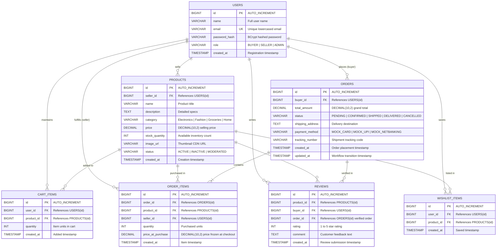

# D1: Entity-Relationship (ER) Diagram — PreethiMart
**Anna University R2025 Semester 3 Capstone**

The following Mermaid diagram visualizes the complete database schema for **PreethiMart**, including entities, primary keys, foreign keys, relationships, and data types (utilizing `DECIMAL(10,2)` for financial precision and audit timestamps).

