# D2: Use Case Diagram — PreethiMart
**Anna University R2025 Semester 3 Capstone**

The following diagram illustrates system use cases across the primary actors: **Buyer**, **Seller**, **System Administrator**, and the **AI Assistant (PreethiBot)**.

```mermaid
flowchart TD
    subgraph Actors
        Buyer["🧑 Buyer / Customer"]
        Seller["💼 Merchant / Seller"]
        Admin["🛡️ System Administrator"]
        AI["🤖 PreethiBot Assistant"]
    end

    subgraph "Core Authentication (F1)"
        UC_Reg["Register Account (Buyer/Seller)"]
        UC_Login["Sign In (BCrypt & Session Management)"]
        UC_Logout["Log Out (Invalidate Session)"]
    end

    subgraph "Shopping Experience (F2 - F5, O1)"
        UC_Browse["Browse Catalog & Category Filter (F3)"]
        UC_Search["Keyword Search & Pagination (F3)"]
        UC_Cart["Manage Cart & Quantity (F4)"]
        UC_Wishlist["Save to Wishlist (O1)"]
        UC_Checkout["Mock Payment Checkout (F5)"]
    end

    subgraph "Orders & Reviews (F6, F8, O2)"
        UC_BuyerOrders["View Order History & Status Timeline (F6)"]
        UC_Review["Submit Verified Purchase Review (F8)"]
        UC_SellerOrders["Fulfill Incoming Orders & Update Workflow (F6, O2)"]
    end

    subgraph "Merchant Management (F2, O3)"
        UC_CreateListing["Create New Product Listing (F2)"]
        UC_EditListing["Edit Price & Stock Levels (F2)"]
        UC_DeleteListing["Delete Listing (F2)"]
    end

    subgraph "Administration & Moderation (F7)"
        UC_ViewUsers["Audit All Users & Delete Accounts"]
        UC_ViewOrders["Supervise Platform Orders & GMV"]
        UC_Moderate["Moderate / Suspend Product Listings"]
    end

    subgraph "AI Assistant (O4)"
        UC_ChatFAQ["Ask FAQ (Shipping, Returns, Orders)"]
        UC_ChatRecs["Get Catalog Recommendations"]
    end

    %% Buyer Relations
    Buyer --> UC_Reg
    Buyer --> UC_Login
    Buyer --> UC_Logout
    Buyer --> UC_Browse
    Buyer --> UC_Search
    Buyer --> UC_Cart
    Buyer --> UC_Wishlist
    Buyer --> UC_Checkout
    Buyer --> UC_BuyerOrders
    Buyer --> UC_Review
    Buyer --> UC_ChatFAQ

    %% Seller Relations
    Seller --> UC_Reg
    Seller --> UC_Login
    Seller --> UC_Logout
    Seller --> UC_CreateListing
    Seller --> UC_EditListing
    Seller --> UC_DeleteListing
    Seller --> UC_SellerOrders

    %% Admin Relations
    Admin --> UC_Login
    Admin --> UC_Logout
    Admin --> UC_ViewUsers
    Admin --> UC_ViewOrders
    Admin --> UC_Moderate

    %% AI Relations
    AI --> UC_ChatFAQ
    AI --> UC_ChatRecs
```

