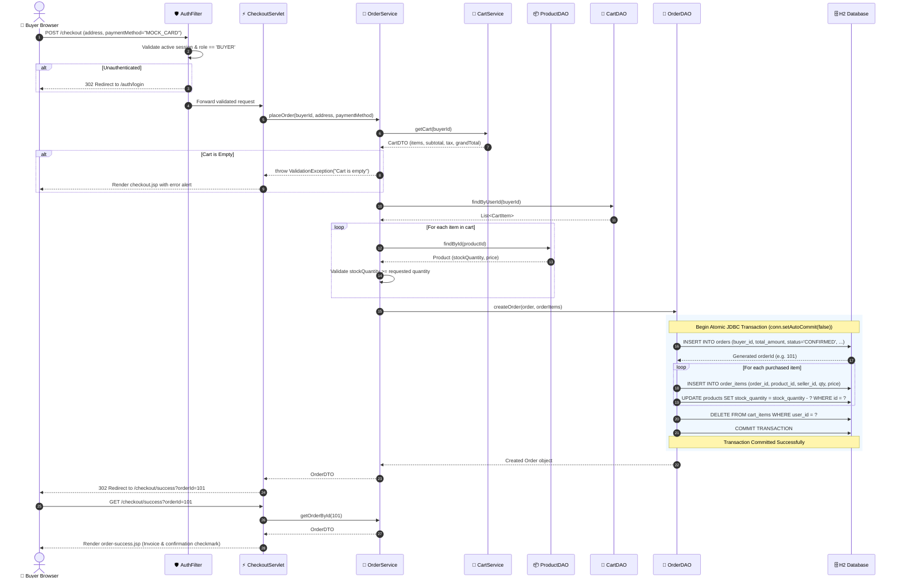

# D3: Sequence Diagram — PreethiMart Place Order & Checkout Flow
**Anna University R2025 Semester 3 Capstone**

The following sequence diagram details the complete end-to-end execution flow of the **Place Order & Mock Payment Confirmation Journey** (F4 -> F5 -> F6), demonstrating strict architectural layering across **Browser**, **AuthFilter**, **CheckoutServlet**, **OrderService**, **ProductDAO**, **CartDAO**, **OrderDAO**, and the **H2 Relational Database**.

